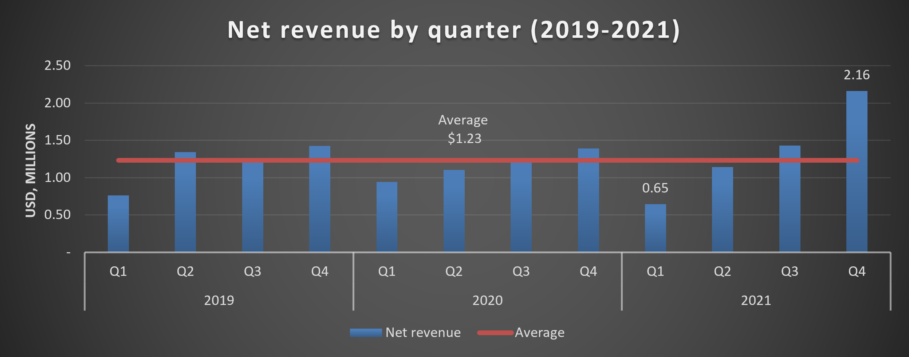
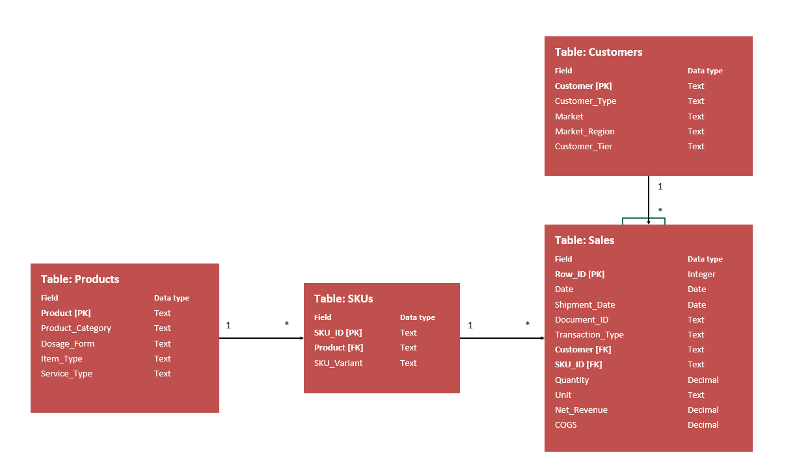
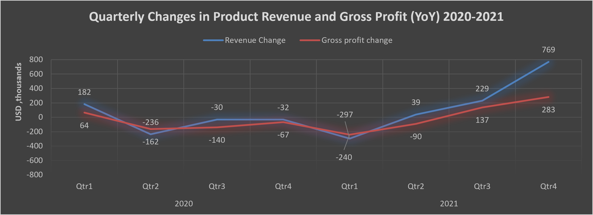
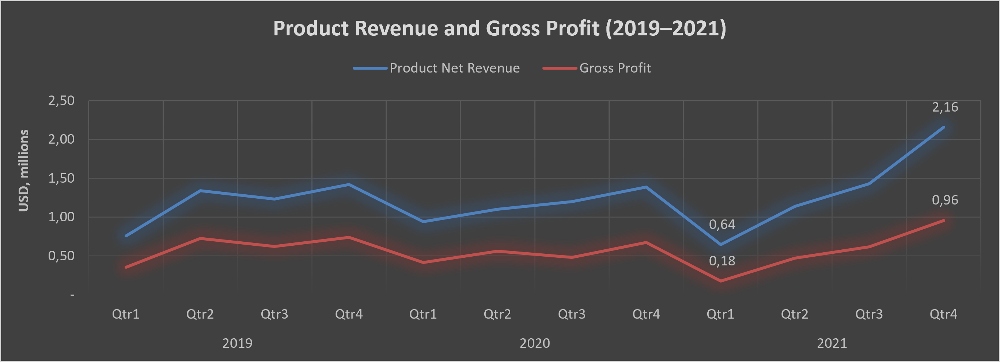
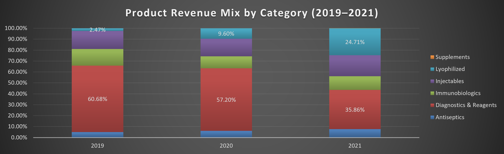
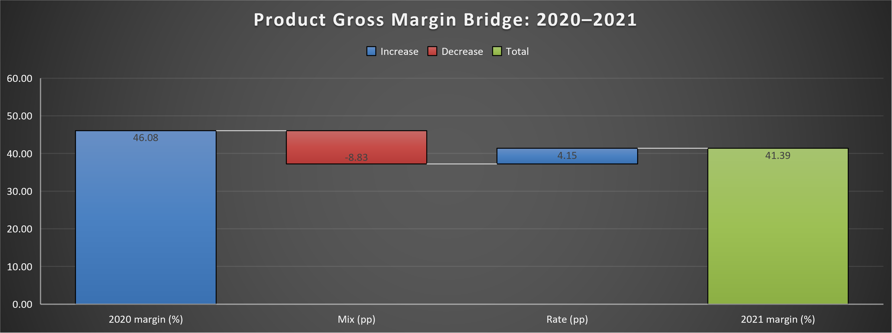
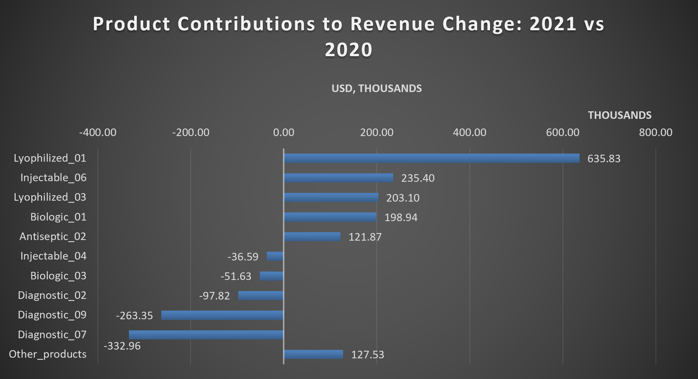

# PigulkaBio: Sales and Profitability Analysis (2019–2021) 

## Client Background

PigulkaBio is a fictional pharmaceutical company serving domestic and export markets through distributors and other business customers. Its portfolio includes diagnostics and reagents, immunobiologics, injectables, lyophilized products, antiseptics, and supplements. The company also generates a small share of revenue from services.

This case study covers 2019–2021 and uses a synthetic dataset based on real transactions. The data includes sales, returns, and financial discount adjustments, supporting a comparative analysis of the company’s commercial performance over the three-year period.

## North Star Metrics & Analysis Areas

- **Sales and Profitability Trends**
- **Products and Categories**
- **Customers and Concentration**
- **Discounts, Returns, and Pricing**
- **Domestic and Export**

## Executive summary

2021 KPIs (relative to 2020): net revenue – $5.38 million (+16.0%); product gross profit – $2.22 million (+4.2%); product gross margin – 41.4% (-4.7 percentage points).

### 1. Revenue Growth and Peak Performance

- In 2021, net revenue reached $5.38 million, marking the highest figure during the analyzed period. In 2020, it amounted to $4.64 million, compared to $4.76 million in 2019.
- Following a 2.5% decline in 2020, revenue recovered, showing an increase of 16.0%—or $740,000. Compared to 2019, revenue grew by 13.1%, or $624,000.
- Average quarterly revenue in 2021 was $1.35 million, exceeding the average for the entire period ($1.23 million). For comparison, this figure was $1.19 million in 2019 and $1.16 million in 2020.

### 2. Quarterly Patterns and Key Changes

- Across all three years, Q1 accounted for the smallest share of annual revenue, while Q4 accounted for the largest.
- In 2021, the concentration of revenue toward the end of the year intensified. Q4 accounted for $2.16 million—or 40.1% of annual revenue—compared to 29.9% in 2019 and 30% in 2020. Q1 2021 generated $647,000 (12%), marking the quarter with the lowest revenue for the entire period.

### 3. Key Takeaways and Recommendations

- The recovery in revenue was accompanied by an increased concentration in Q4. When planning for the next period, it is necessary to assess the likelihood that the elevated sales levels seen at the end of 2021 will recur.
- Conduct a more detailed analysis of the customers and products that drove the results for Q1 and Q4. Use these findings to refine the quarterly sales and shipment plan. 

## ERD

The dataset consists of: Sales (3,560 transaction lines, including sales, returns, and discounts), Products (a catalog comprising 34 products and 5 types of services), SKUs (101 product variants), and Customers (a directory of 43 clients). 

The relationships between the tables are illustrated in the ERD visualization.

## Insights and Deep-Dive
All metrics in the Deep-Dive section are calculated based on products only; all service-related transactions are excluded. The primary comparison is between 2021 and 2020.

### Sales and profitability trends

#### Revenue and Gross Profit Recovery

- Product revenue grew by 16%, reaching $5.37 million. Gross profit increased by 4.2%, rising from $2.13 million to $2.22 million. The growth in sales was accompanied by a less pronounced increase in gross profit.
- When comparing 2021 to 2019, product revenue increased by 13.1%, while gross profit remained 8.9% lower. The recovery in revenue did not restore gross profit to its initial level.

#### Gross Margin Trend

- Gross margin declined consistently over the three-year period: 51.4% in 2019, 46.1% in 2020, and 41.4% in 2021—representing year-over-year decreases of 5.3 percentage points and 4.7 percentage points, respectively.
  
#### Quarterly Contributions

- The trends for revenue and gross profit diverged in certain quarters. In Q2 2021, product revenue increased by $39,000, while gross profit decreased by $90,000 compared to the same quarter in 2020.
- Following a decline in revenue of $297,000 and in gross profit of $240,000 in Q1, the second half of the year bolstered the annual performance. Q4 delivered the most significant growth, contributing $769,000 in revenue and $283,000 in gross profit (year-over-year increases). These figures exceeded the net annual growth for both metrics, offsetting the declines seen in other quarters.

### Products and Categories

  

  
  

#### Best and Worst Performers

- Diagnostic_09 remained the leader in terms of revenue, generating $1.52 million in revenue and $959,000 in gross profit. Other top performers by revenue included Lyophilized_01 ($966,000) and Biologic_03 ($420,000).
- Lyophilized_01 saw the largest revenue increase, up by $636,000. Other products that contributed positively to the results were Injectable_06 (+$235,000), Lyophilized_03 (+$203,000), and Biologic_01 (+$199,000).
- The most significant revenue declines were recorded for Diagnostic_07 (-$333,000) and Diagnostic_09 (-$263,000). Despite this drop in sales, the leading product (Diagnostic_09) managed to retain its top position. 

#### Product Trends, 2019–2021

- The Diagnostics & Reagents category saw a significant decline in its share of product revenue: from 60.7% in 2019 to 57.2% in 2020 and 35.9% in 2021. Over the last year, revenue for this category fell by $723,000, and gross profit decreased by $407,000.
- The Lyophilized category emerged as the primary driver of growth. Its share rose from 2.5% in 2019 to 9.6% in 2020 and 24.7% in 2021. Compared to 2020, it contributed an additional $883,000 in revenue and $294,000 in gross profit.
- Dependence on the leading product has decreased. The share of Diagnostic_09 in product revenue declined from 53.2% in 2019 to 38.6% in 2020, settling at 28.4% in 2021.

#### Product Mix and Margin

- Changes in the sales mix reduced the overall margin by 8.8 percentage points (p.p.), while margin improvements within individual categories offset 4.1 p.p. of this decline. Consequently, the product margin decreased from 46.1% to 41.4%.
- The margin for the Lyophilized category rose from 14.5% to 27%, yet it remained significantly lower than the margin for Diagnostics & Reagents, which stood at 61.9% in 2021. The increased share of Lyophilized products supported revenue while simultaneously altering the overall profitability of the product mix.

### Customers and Concentration

#### Top customers: Revenue vs. Gross Profit
 
- The largest customers were Customer 42 ($1.97 million), Customer 02 ($1.18 million), and Customer 35 ($472,000) in terms of product revenue.
- Customer 02 was the leader in terms of gross profit, generating $581,000 with a margin of 49.5%. Customer 42, despite having higher revenue, contributed $507,000 in gross profit with a margin of 25.7%. The leader in terms of revenue was not the same as the leader in terms of gross profit.

#### Biggest Changes

- The primary growth was driven by Customer 42 and Customer 02. For Customer 42, product revenue increased by $1.03 million, and gross profit by $323,000. For Customer 02, the increases were $402,000 and $250,000, respectively.
- The most significant declines were seen with Customer 35 and Customer 14. Revenue for Customer 35 fell by $785,000, with a $488,000 drop in gross profit. For Customer 14, the decreases were $369,000 and $208,000, respectively.
- There were no product sales for Customer 25 or Customer 01 in the 2019–2020 data. In 2021, however, they generated $375,000 and $111,000 in product revenue, respectively, contributing to the annual result.

#### Top-3 Revenue Share

- Dependence on the largest customers has intensified. The share of the top 3 customers grew from 57.4% in 2019 to 64.1% in 2020 and 67.3% in 2021. While the composition of this group remained the same—Customer 42, Customer 02, and Customer 35—their relative positions shifted.

### Discounts, Returns, and Pricing

#### Discount and Return Trends

- Financial discounts have shown a consistent decline: from $60,500 in 2019 to $24,600 in 2020, and further to $21,600 in 2021. Their rate decreased from 1.26% to 0.53% and 0.4%, respectively.
- Returns peaked in 2020, reaching $30.8 thousand, or 0.66% of sales revenue. In 2021, this figure fell to $686, or 0.01%.

#### Pricing Exceptions

- The number of sales below cost dropped from 93 line items in 2020 to 19 in 2021. The total gross loss decreased from $15.1 thousand to $9.4 thousand.
- In 2021, a total of 25 pricing exceptions were identified: 19 sales below cost and 6 in a separate category of deep discounts. No free product shipments were recorded in 2021.

#### Concentration and Financial Impact

- In 2020, a significant portion of the gross loss from exceptions was attributed to the product Lyophilized_01 sold to Customer 42 — comprising 30 line items and a loss of $10.7 thousand. This points to a specific area where sales terms and conditions should be reviewed.
- While the number of sales below cost and the associated gross loss have declined, the overall product margin has continued to fall. Margin decomposition reveals that the primary negative impact stems from the product mix.

### Domestic and Export

#### Market Performance, 2019–2021

- The domestic market saw revenue grow from $3.49 million in 2020 to $4.7 million in 2021. Gross profit increased from $1.54 million to $1.89 million; however, the margin declined from 44.1% to 40.2%.
- Export revenue fell from $1.14 million to $669,000, and gross profit dropped from $594,000 to $335,000. Exports maintained a higher margin—50%—though this was a decrease from 52.1% in 2020.
- The share of exports decreased to 12,5% of total product revenue, compared to 24.6% in 2020 and 18.3% in 2019. Domestic sales accounted for 87.5% of product revenue.

#### Export Regional Changes

- The primary decline in exports occurred in Export Market C and Export Market E, with revenue drops of $369,000 and $107,000, respectively. Total export revenue decreased by $471,000.
- Growth in Export Market A ($48,000) and Export Market D ($3,000) was insufficient to offset the declines in other regions. There were no sales in Export Market B during 2021.

#### Product Mix by Market

- In the domestic market, Diagnostics & Reagents accounted for 34.4% of revenue, followed by Lyophilized products (28.2%) and Injectables (21.6%). Exports were dominated by Immunobiologics (52.8%) and Diagnostics & Reagents (46.1%).
- Differences in market profitability should be evaluated in the context of their respective product mixes. All Lyophilized revenue was generated in the domestic market, whereas exports were concentrated primarily in Immunobiologics and Diagnostics & Reagents. 

## Overall Findings

- The company has recovered its revenue, but not its gross profit, compared to 2019. Net revenue in 2021 reached a period high, while product gross profit remained 8.9% below 2019 levels. Margins have declined consistently over the three-year period.
- The most significant shift in profitability is linked to the product mix. Growth in the Lyophilized segment was accompanied by a reduction in the share of high-margin diagnostics. Margin improvements within individual categories only partially offset this negative impact.
- Growth in the Lyophilized category is concentrated within a single major buyer. In 2021, Customer 42 accounted for $1.26 million, or 94.6%, of the category's revenue. This links the shift in the product mix to a heavy reliance on a key client; the category’s future performance is highly dependent on this client’s purchasing activity.
- Business concentration has shifted. While dependence on the leading product has decreased, the share of the top three clients has risen to 67.3%. Simultaneously, the importance of the domestic market and sales generated in the final quarter has increased.

## Recommendations

### Sales and Profitability

- Plan revenue in conjunction with gross profit and margins. Further analyze the composition of sales in Q1 and Q4, and assess whether the elevated sales levels seen at the end of 2021 are likely to recur, before finalizing quarterly plans.

### Products and Categories

- Investigate the decline in Diagnostics & Reagents sales, broken down by product and client. Continue developing the Lyophilized category while monitoring gross profit and margins, given the impact this growing category has on the overall profitability of the product portfolio.

### Customers and Concentration

- Clarify the purchasing plans of major buyers, and investigate the reasons behind the performance decline for Customer 35 and Customer 14. When developing client relationships, consider each client's contribution to gross profit and the business's overall reliance on its top three customers.

### Discounts, Returns, and Pricing

- Verify the economic rationale behind sales made below cost and the application of deep discounts, analyzed at the level of individual products and clients. Monitor the frequency of such exceptions and their gross profit impact, keeping in mind that the cost model is synthetic in nature.
- Review the sales terms for Injectable_07 to Customer 03. In 2021, this specific product-client pairing involved 16 line items below cost, resulting in a cumulative gross loss of $8,500. Clarify the economic justification for these price concessions and monitor the gross profit outcome of such transactions. 

### Domestic and Export Markets

- Analyze the decline in sales in Export Market C and Export Market E. Evaluate the future development of these markets in terms of revenue, gross profit, and product mix, taking into account higher export margins alongside declining export revenue.

